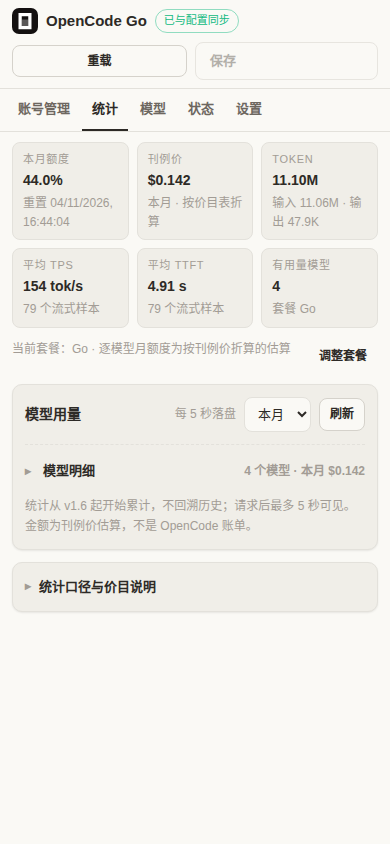
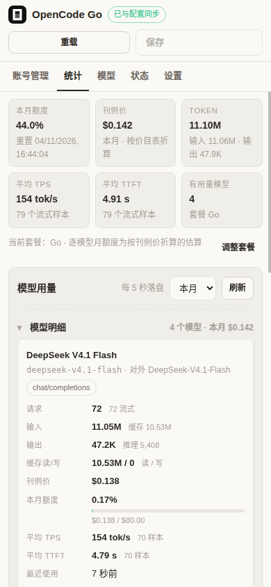
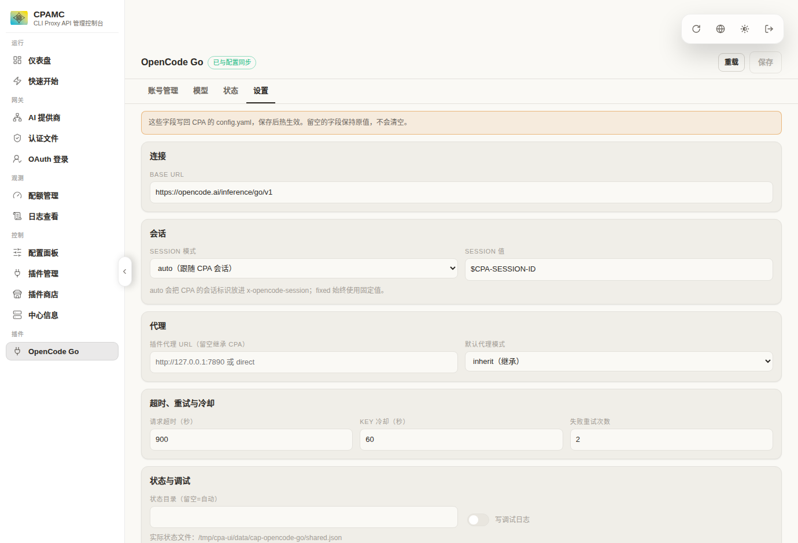
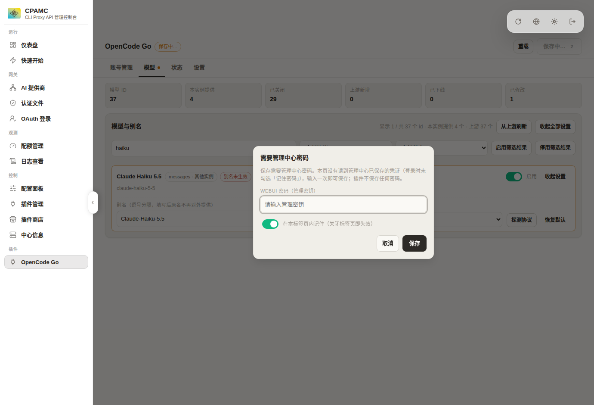
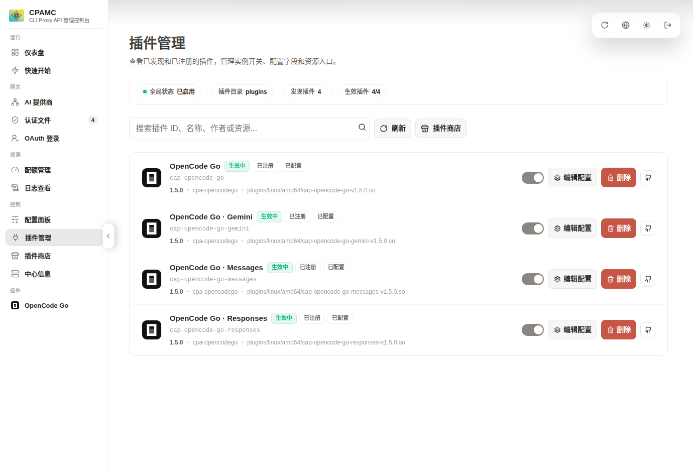
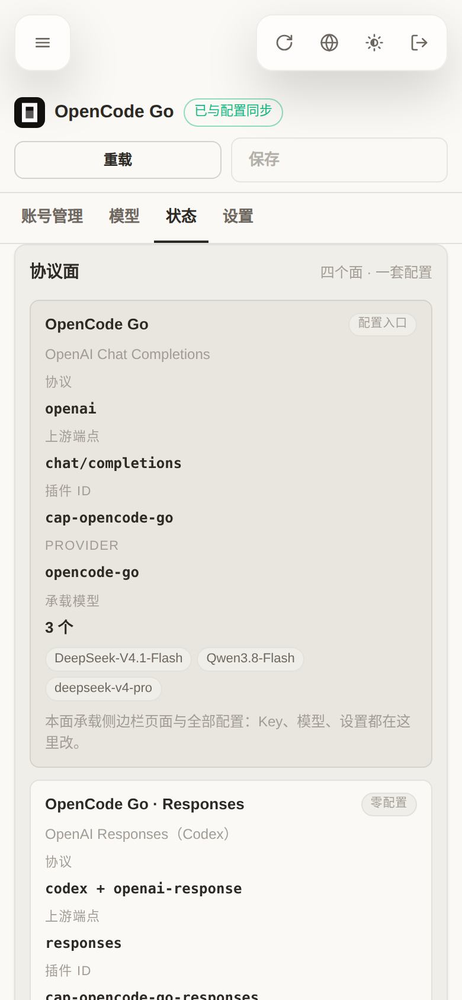
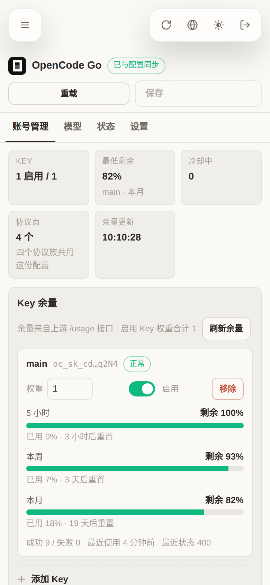
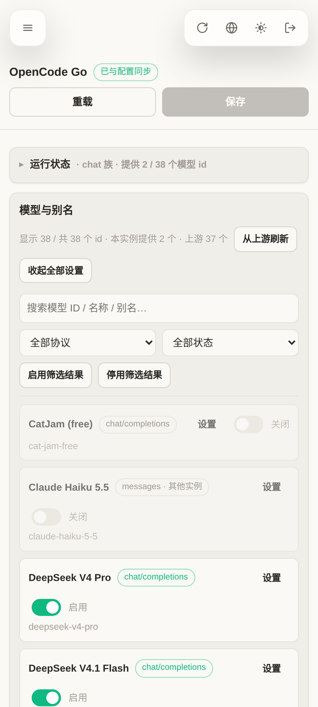
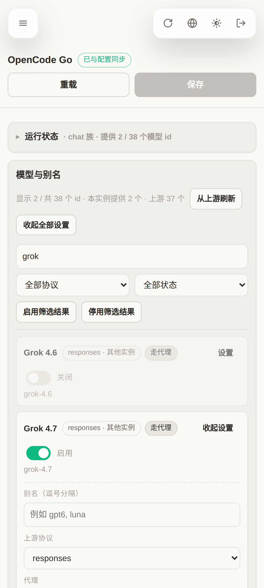
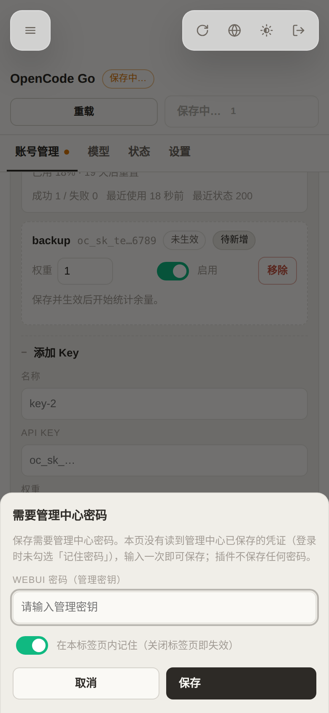

# cpa-opencodego — CLIProxyAPI 的 OpenCode Go Provider 插件

把 [OpenCode Go](https://opencode.ai/docs/go/) 的全部 37 个模型接入 CLIProxyAPI，作为**独立插件**提供，
不改动 CPA 源码，删除插件后不留任何残留。

- 4 个上游协议族全部可用：`chat/completions`、`responses`、`messages`、`gemini generateContent`
- **Gemini 4 Argon Contributor 可用**（CPA 内置 `gemini` provider 组因强制拼接 `/v1beta/` 无法调用它）
- 客户端任意协议都能调用任意模型，协议转换由 **CPA 自己**完成
- 侧边栏「插件」组内出现 `OpenCode Go` 入口，与 token 用量插件平级
- **「统计」Tab**：按用过的模型看 token、刊例价、月额度百分比、平均整体 TPS / 生成 TPS / 首内容 TTFT；
  可从旧 Token Usage Tracker 回放 opencode-go 历史；手机端概览常驻，模型明细与统计口径默认折叠
- **界面跟随管理中心的深色/浅色主题**（实时同步），并在手机宽度下自动改为单列卡片布局
- **插件页不需要密码**：写入凭据直接复用管理中心已经存好的登录态，插件自己不保存任何密码
- **逐模型别名（重命名语义）**：别名会**替代**原名成为唯一的对外模型 id，模型列表与路由都只认别名，
  与 CPA 自身的模型别名行为一致
- 逐模型选择是否走代理（直连 / 代理），真实生效
- **逐模型「设置」按钮**：别名 / 协议 / 代理收进展开面板，折叠时用 chip 显示已改动的项
- **模型搜索框 + 吸顶筛选行**：按 ID / 名称 / 别名搜索，按协议族与状态过滤
- **协议族自动推断**：上游新增的模型按 ID 前缀自动判定走哪个端点，UI 标注「协议推测」，并可一键「探测协议」实测确认
- 多账号 Key 池：加权轮询 + 失败冷却 + 自动切换
- 额度面板：读上游 `/usage` 显示 5 小时 / 本周 / 本月已用百分比与重置时间
- 完全可回滚：删除 4 个 `.so` + 4 个 `plugins.configs.*` 块 + 1 个数据目录即可

---

## 1. 架构：为什么是 4 个 .so

CPA 的插件 executor 以**声明式协议格式**工作：插件声明自己只会一种线上格式
（`executor_input_formats` / `executor_output_formats`），CPA 负责把所有客户端协议翻译成它，
以及把它的输出翻译回客户端协议。

而 OpenCode Go 的模型分布在 4 个上游端点上：

| 上游端点 | 协议格式 | 模型 |
|---|---|---|
| `POST {base}/chat/completions` | `openai` | GLM / Kimi / MiMo / DeepSeek / Qwen / LongCat / Space Bunny / Step5 / MiniMax / Omen … |
| `POST {base}/responses` | `codex` + `openai-response` | Grok 4.7 / 4.6、GPT 6 Luna、GPT 5.6 Luna、Muse Spark |
| `POST {base}/messages` | `claude` | Claude Haiku 5.5 |
| `POST {base}/models/{id}:generateContent` | `gemini` | Gemini 4 Argon Contributor |

格式声明是 per-provider 的，模型所需协议是 per-model 的，因此一个 provider 无法同时承载多种上游协议，
除非插件自己实现协议转换（那要么绑定 CPA 内部包，要么手写转换器，都与"只做消费层"相悖）。

于是同一个程序被编译 4 次（仅链接期常量不同），各自成为一个 provider：

| 插件 ID | provider key | 声明格式 | 上游 |
|---|---|---|---|
| `cap-opencode-go` | `opencode-go` | `["openai"]` | `/chat/completions` |
| `cap-opencode-go-responses` | `opencode-go-responses` | `["codex","openai-response"]` | `/responses` |
| `cap-opencode-go-messages` | `opencode-go-messages` | `["claude"]` | `/messages` |
| `cap-opencode-go-gemini` | `opencode-go-gemini` | `["gemini"]` | `models/{id}:generateContent` |

**只有主插件（`cap-opencode-go`）** 带 `management_api` 与侧边栏菜单，因此 UI 上只有一个入口；
主插件同时是唯一配置源，把解析后的配置写入 `<CPA 根>/data/cap-opencode-go/shared.json`，
其余三个实例按 mtime 惰性读取。四个实例都声明 `model_router`，只认领自己协议族且被启用的模型，
因此可以稳定压过内置 provider 的同名模型（例如现网由 codex OAuth 提供的 `gpt-6-luna`）。

**v1.5 起，「插件管理」里的四行读起来是一个产品的四个协议面**：四个 `.so` 声明同一个
OpenCode 图标（`internal/brand` 内嵌的官方 mark，以 data URI 下发，侧边栏入口同源同图）、
名称分别是 `OpenCode Go` / `OpenCode Go · Responses` / `OpenCode Go · Messages` / `OpenCode Go · Gemini`，
并且**只有主插件声明配置字段**——另外三个的配置块只有 `enabled`，它们读主插件发布的共享快照，
把字段列在它们的表单里只会误导。四个面必须同版本安装；面的职责、承载模型与缺失后果在仪表盘
「状态 → 协议面」里逐面写明。为什么不能合并成一个 `.so` 见 [docs/design.md](docs/design.md)。

数据流：

```
客户端(任意协议) → CPA 翻译成插件声明格式 → 插件选 Key/选传输 → 原样 POST 上游
                → 上游字节原样回吐 → CPA 翻译回客户端协议
```

插件**不改写 JSON 协议体**（唯一例外：把 body 里的 `stream` 字段与传输模式对齐）。

### 统计的数据来自哪

主面（`cap-opencode-go`）额外声明 `usage_plugin`，接收宿主在请求结束后投递的 usage 事件，
因此 token / 缓存 / 失败 / 请求总延迟都由宿主统一解析，插件不解析响应来数 token。
实测宿主对本插件的异步流桥接**不提供 TTFT**（`ttft_ns=0`），所以四个面各自在读取上游 SSE 时
测量首个内容帧，写入 `data/cap-opencode-go/stats-<role>.json`；主面的 `/api/stats`
把自己的 token 计数与三个从属面的 timing 文件合并。

口径刻意保持可配对：

- **TPS = 成功请求的有效 output token ÷ 宿主请求总延迟**。分子和分母来自同一条 usage 记录，
  包含首字、排队和网络时间，所以叫「整体 TPS」，不是纯解码速度；gemini 的 reasoning token
  计入分子；失败请求不计。非流式请求也有总延迟，因此也计入整体 TPS。
- **生成 TPS = 插件实测的 output / 首个内容帧到最后一个内容帧的时间**，不含 TTFT，接近解码速度。
  这是次要估算：宿主 usage 没有可与 timing 配对的 request id，分子覆盖成功流式 output，分母只覆盖
  有 generation 的样本；按 timing 覆盖率缩放，样本数见列，不单独做严格 SLA。
- **TTFT = 发起上游请求到首个真实内容帧**。只统计有内容且正常结束的流式请求；内容识别失败时
  **不再回退到首帧**，避免把 role/控制帧当成首字。TTFT 包含连接、排队和重试，不含 host 下游发送。

费用按内嵌价目表折算，不是 OpenCode 账单。详见 [docs/design.md](docs/design.md) §7.8。

### 回放旧 Token Usage Tracker

v1.7 附带一次性的 `cmd/replay-tracker`：读取 `cap-token-usage-tracker` 的 bbolt 库，只挑
`openai-compatible-opencode go` / `cap-opencode-go*` 的逐请求记录，按当前价目表重算费用，
合并进 `stats-chat.json`。它只解析 token/延迟等统计字段，不写出 Key、提示词或响应正文。

```bash
# 先停 CPA，避免运行中的 stats 写入覆盖合并结果
systemctl stop cliproxyapi
make VERSION=1.7.3 GO=/opt/go/bin/go replay
./dist/replay-tracker-v1.7.3 \
  -tracker /root/cliproxyapi/data/token-usage-tracker.db \
  -stats-dir /root/cliproxyapi/data/cap-opencode-go
# 上面的默认是 dry-run；确认扫描数量和截止时间后再加 -apply
./dist/replay-tracker-v1.7.3 \
  -tracker /root/cliproxyapi/data/token-usage-tracker.db \
  -stats-dir /root/cliproxyapi/data/cap-opencode-go -apply
systemctl start cliproxyapi
```

默认只导入「现有 stats 最早一条记录之前」的历史，避免和已经存在的统计重复；导入前会把
`stats-*.json` 备份到临时目录，成功后写 `replay-tracker-import.json` 标记，默认拒绝第二次导入。
旧 tracker 的 `ttft_ns` 为 0 的请求只回放 token/费用/总延迟，不伪造 TTFT。

---

## 2. 环境要求

- CLIProxyAPI v8.x，且构建时 `CGO_ENABLED=1`（`X-CPA-SUPPORT-PLUGIN: 1`）。v8.0.27 已验证。
- 构建插件需要 Go 1.26+（本机验证使用 go1.27.2）。
- 插件 ABI 是 `dlopen` + C ABI（`abi_version = 1`），**不要求与宿主同工具链、同依赖版本**。

---

## 3. 构建

```bash
# 依赖：只需 public sdk 包 + gopkg.in/yaml.v3
# go.mod 里用 replace 指向本地 CPA 源码；如需改为线上模块，删掉 replace 即可。
export PATH=/opt/go/bin:$PATH
export GOPROXY=https://goproxy.cn,direct GOSUMDB=off

make build VERSION=1.7.3   # 产出 dist/cap-opencode-go{,-responses,-messages,-gemini}-v1.7.3.so
make test           # 单元测试
make vet
```

`go.mod` 通过 `replace github.com/router-for-me/CLIProxyAPI/v8 => ../ref/cpa/CLIProxyAPI-v8`
指向固定版本的 CPA 源码。只 import `sdk/pluginapi`、`sdk/pluginabi`，插件 `.so` 不链接
`bbolt`；只有 `cmd/replay-tracker` / `make replay` 需要 bbolt 与 `golang.org/x/sys`。

---

## 4. 安装

```bash
CPA_ROOT=/root/cliproxyapi bash scripts/install.sh 1.7.3
```

脚本只做两件事：把 4 个 `.so` 复制到 `$CPA_ROOT/plugins/linux/amd64/`，并打印需要粘贴的 YAML。
**它不会修改 config.yaml** —— 插件开关与 provider 配置由宿主配置拥有。

把下面的块并入 config.yaml 的 `plugins:` 段：

```yaml
plugins:
  enabled: true
  dir: "plugins"
  configs:
    cap-opencode-go:
      enabled: true
      priority: 10
      base-url: "https://opencode.ai/inference/go/v1"
      session-mode: "auto"
      session: "$CPA-SESSION-ID"
      default-proxy: "proxy"
      plan: "go"                 # go | go-plus，只影响「统计」的月额度百分比
      keys:
        - name: "main"
          key: "oc_sk_xxx"
          weight: 1
          enabled: true
      models:
        "gpt-6-luna":                 { enabled: true, proxy: proxy }
        "gemini-4-argon-contributor": { enabled: true, proxy: direct }
    cap-opencode-go-responses: { enabled: true }
    cap-opencode-go-messages:  { enabled: true }
    cap-opencode-go-gemini:    { enabled: true }
```

然后 `systemctl restart cliproxyapi`。四个实例必须同时启用。

---

## 5. 配置参考

只有 `plugins.configs.cap-opencode-go` 需要写业务字段，其余三个实例只需 `enabled: true`。

| 字段 | 类型 | 默认 | 说明 |
|---|---|---|---|
| `base-url` | string | `https://opencode.ai/inference/go/v1` | 接口基址；`https://opencode.ai/zen/go/v1` 亦可 |
| `keys` | array | 空 | `[{name, key, weight, enabled}]`，多账号 Key 池 |
| `models` | object | 空 | `{"<model-id>": {enabled, proxy, family, aliases}}` 逐模型覆盖 |
| `models-default` | object | 空 | 未单独列出的模型的统一设置 |
| `default-proxy` | enum | `inherit` | `inherit` / `proxy` / `direct` |
| `proxy-url` | string | 空 | 插件专用代理；留空继承 CPA `requests.proxy-url`；`direct`/`none` 表示强制直连 |
| `session-mode` | enum | `auto` | `auto` 跟随 CPA 会话 ID，`fixed` 用 `session` 值 |
| `session` | string | `$CPA-SESSION-ID` | `x-opencode-session` 的固定值 |
| `request-timeout-seconds` | int | 900 | 上游超时 |
| `key-cooldown-seconds` | int | 60 | Key 失败后冷却时长 |
| `max-retries` | int | 2 | 单个请求最多切换 Key 的次数 |
| `extra-headers` | object | 空 | 追加到上游请求的请求头 |
| `state-dir` | string | `<root>/data/cap-opencode-go` | 插件自有状态目录 |
| `plan` | enum | `go` | OpenCode Go 套餐：`go`（$10/月）或 `go-plus`（$40/月）；只影响统计 Tab 的逐模型月额度百分比 |
| `debug` | bool | false | 写流式诊断到 `<state-dir>/debug.log` |

### 代理语义

按模型解析，优先级：模型级 `proxy` → `default-proxy` → 插件 `proxy-url` → CPA `requests.proxy-url`。

- `proxy`：走插件 `proxy-url`，未设置则走 CPA 全局代理
- `direct`：强制直连（显式设置 `Transport.Proxy = nil`，不受环境变量影响）
- `inherit`：按上面的顺序继承

`gemini-4-argon-contributor` 实测**必须直连**；`gpt-6-luna` / `grok-4.7` 等 responses 家族
实测**必须走代理**（直连返回 `403 unsupported_country_region_territory`），因此安装示例里已分别设置。

### 模型别名（重命名）

别名是**重命名**，不是新增：配置后客户端只能看到、也只能调用别名，原名在模型列表与路由上都不再存在。
这与 CPA 自身的模型别名（`oauth-model-alias` 的 `alias`、`openai-compatibility` 的 `alias`）行为一致 ——
上游仍然是原名，客户端只认别名，别名继承基础模型的协议族、代理与 Key：

```yaml
models:
  "deepseek-v4.1-flash":
    aliases: ["DeepSeek-V4.1-Flash"]   # 数组；仪表盘里用逗号分隔填写
  "grok-4.7":
    enabled: true
    proxy: proxy
    aliases: ["grok", "grok4"]         # 多个别名 = 同一模型的多个对外名
```

上例中 `/v1/models` 只会列出 `DeepSeek-V4.1-Flash`、`grok` 与 `grok4`；
请求 `deepseek-v4.1-flash` 会得到 `400 model_not_found`，因为该 id 已经不存在了。

- 别名会注册进 `/v1/models`（`owned_by: opencode`）与 `/v1beta/models`（gemini 客户端的 `models/<别名>`）
- 路由阶段按别名认领，执行阶段由插件把请求体里的 `model`（gemini 是 URL 路径）改写成真实上游 id
- 多个别名等价于 CPA 的「同一 name 重复配不同 alias」：一个上游模型对外暴露多个名字
- 别名与**任何真实模型 id** 冲突时**真实 id 优先**：该别名被忽略并在仪表盘标记「别名被占用」；
  若某模型的别名全部被忽略，它保留自己的原名继续提供（不会凭空消失）
- 关闭某模型时，它的别名一并失效
- 别名不会跨协议族：别名继承基础模型的协议族（例如 `responses`）
- 仪表盘里每个真实模型只有一行，行上直接显示「对外 id」；别名一栏填写后原名即被替换

> 上游新增的模型（`/api/models` 里标记「上游新增」）默认**不启用**。在仪表盘上给它选一个「上游协议」并打开开关即可使用，无需重新编译插件。

### Key 池

加权轮询（`weight`），上游 401/403/408/429/5xx 时自动换下一个 Key 并在冷却期内跳过它；
400/404 视为请求本身的问题，不换 Key，原样回传上游错误与状态码。

---

## 6. 仪表盘

侧边栏「插件」组 → `OpenCode Go`（iframe，路径 `/v0/resource/plugins/cap-opencode-go/dashboard`）。

页面分 5 个 Tab，**默认打开「账号管理」**——打开页面第一眼就是各 Key 的剩余额度：

| Tab | 内容 |
|---|---|
| **账号管理**（默认） | 汇总条（启用 Key 数 / 最低剩余 / 冷却中 / 余量更新时间）；每个 Key 一张卡片：名称、掩码、健康状态、权重、启用开关、移除，以及 5 小时 / 本周 / 本月三条**剩余**进度条（含重置时间）；折叠的「添加 Key」表单；底部「轮换与故障转移」摘要 |
| **统计** | 概览（账户本月额度 / 刊例价 / token / 平均整体 TPS / 生成 TPS / 首内容 TTFT / 有用量模型）；「本月 / 累计」切换；每个用过的模型一行：输入、输出、缓存读/写、刊例价、月额度百分比、平均整体 TPS、生成 TPS、首内容 TTFT、最近使用；「统计口径与价目说明」默认折叠 |
| **模型** | 统计 chip（模型 id / 本实例提供 / 已关闭 / 上游新增 / 已下线 / 已修改，点一下即按它筛选）；搜索 + 协议 + 状态筛选、「启用/停用筛选结果」、「从上游刷新」；每个模型一行，点「设置」展开别名 / 上游协议 / 代理 / 探测协议 / 恢复默认 |
| **状态** | 运行状态（版本、协议族、Base URL、Session、代理、状态文件、启动时间与运行时长）；上游模型列表（数量、拉取时间、结果）；**协议面**卡片（四个 `.so` 各自的协议、插件 ID、承载模型、配置归属与缺失后果）；「关于与帮助」 |
| **设置** | Base URL、Session、代理、超时/冷却/重试、状态目录与调试日志；底部「待保存的修改」逐条列出本次改动，可一键放弃 |

保存按钮：**没有改动时是灰的；一旦有改动就亮起来**，角标显示改动条数（`保存 3`），
标题旁的 chip 同步显示「3 项未保存」，对应 Tab 上出现小圆点。

| 桌面端 · 账号管理（默认 Tab） | 桌面端 · 模型 |
|---|---|
|  |  |

| 桌面端 · 统计 | 手机端 · 统计（明细折叠） | 手机端 · 统计（展开明细） |
|---|---|---|
|  |  |  |

| 桌面端 · 状态 | 桌面端 · 设置 | 保存前弹出密码框 |
|---|---|---|
|  |  |  |

| 桌面端 · 状态 | 桌面端 · 设置 | 保存前弹出密码框 |
|---|---|---|
|  |  |  |

| 「插件管理」里的四个协议面 | 手机端 · 协议面 |
|---|---|
|  |  |

| 手机端 · 账号管理 | 手机端 · 模型 | 手机端 · 逐模型设置 | 手机端 · 密码框 |
|---|---|---|---|
|  |  |  |  |

### 插件管理里的四个协议面（v1.5）

CPA 的插件列表是「一个 `.so` 一行」，而本插件按上游协议族拆成四个 `.so`，于是那里会出现四行。
这四行现在被组织成一个产品的四个面，而不是四个要分别照管的插件：

| 行 | 协议 | 需要配置吗 | 这只面负责 |
|---|---|---|---|
| `OpenCode Go` | `openai` → `/chat/completions` | **是（唯一配置入口）** | Key 池、29 个 chat 模型、仪表盘与全部设置 |
| `OpenCode Go · Responses` | `codex` + `openai-response` → `/responses` | 否（零配置） | Grok / GPT / Muse 系模型 |
| `OpenCode Go · Messages` | `claude` → `/messages` | 否（零配置） | Claude 系模型 |
| `OpenCode Go · Gemini` | `gemini` → `models/{id}:generateContent` | 否（零配置） | Gemini 系模型 |

- **图标**：四行与侧边栏入口都用 OpenCode 官方 mark（`internal/brand/opencode.svg`，
  取自 <https://opencode.ai/favicon.svg>，以 `data:image/svg+xml;base64,…` 内嵌下发，
  不依赖任何外部请求）。OpenCode 图标 © SST（MIT），此处仅用于标识本插件对接的上游服务。
- **零配置**：三个从属面的 `plugins.configs.<id>` 只需要 `enabled: true`；它们的配置字段不再出现在
  表单里（`configFields()` 只对主面返回字段）。旧配置里写在从属面的字段仍会被解析，但只有
  `shared.json` 缺失时才会被使用，正常运行时以主面发布的快照为准。
- **同版本**：四个 `.so` 必须一起升级。从属面不注册管理路由，插件侧读不到它们的版本，
  因此这条只能靠约定——升级时把四个文件一起换掉（`scripts/install.sh <版本>` 一次装四个）。
- **缺失/停用的后果**：该协议族的模型无法路由（例如停用 `…-gemini` 后 Gemini 族模型不可用），
  其它协议族不受影响。「状态 → 协议面」里逐面标注了这一条。

### 保存与密码（v1.4 起没有「只读」模式）

页面**不读取 Key 明文，也不需要预先登录**：显示用的数据全部来自插件自己的免鉴权只读接口，
所以在任何情况下都能查看和编辑，不存在「只读」。只有**写**的时候才需要管理凭证：

- 管理中心登录时勾了「记住密码」→ 页面**静默复用** `localStorage['cli-proxy-auth']` 里的管理密钥
  （zustand persist + `enc::v1::` 混淆；旧版 `localStorage['managementKey']` 兜底），不会打扰你
- 没勾「记住密码」→ 点「保存」时**弹一次密码框**（输入 WebUI 密码 / 管理密钥）。
  输错会在框内提示「连续输错 5 次会临时封禁当前 IP」；勾上「在本标签页内记住」后，
  本次标签页会话里不再重复询问（存 `sessionStorage`，关掉标签页即失效）
- 保存是**合并写**：页面把改动记成一份补丁（`models.<id>` 的字段、`keys` 的增删改、若干顶层标量），
  保存时先读回宿主当前的配置块，把补丁叠上去再 PUT。因此页面从不需要 Key 明文，
  也不会覆盖它没读到的字段（手改过的配置、`extra-headers`、`models-default` 等原样保留）；
  Key 的增删只影响卡片上列出的那些名字
- 插件自身不在磁盘上保存任何凭据；只有主动勾选「在本标签页内记住」时，
  密码才会写进浏览器 `sessionStorage`

### 手机端布局

- 页面是「顶部操作栏 + Tab 条 + 单块可滚动区域」的 flex 列，**刻意不放底部固定条**：
  管理中心在手机上会用自己的 `min-height:100vh` 撑页面，iframe 下方可能留出一条它自己的空白，
  任何贴底元素都会浮在那条空白上方。操作栏放在顶部后，页面在 iframe 底边自然结束
- 顶部内容按**实测**的管理中心 header 高度（`--host-header`）下移，header 不会压住插件内容
- Tab 条在窄屏可横向滑动；≤900px 收窄为两列，≤640px 变单列卡片、模型设置面板单列、
  密码框变成贴底 bottom sheet、按钮等宽，可点区域 ≥ 40px 高
- **统计 Tab 不把内容平铺**：概览常驻；「模型明细」在 ≤640px 默认折叠，点开才展开卡片；
  「统计口径与价目说明」始终折叠。这样手机首屏是几个关键数字，而不是十几列 token 数

写入后宿主热重载并回调 `plugin.reconfigure`，插件**不直接写 config.yaml**。

只读接口（同源 iframe、免鉴权、绝不返回明文 Key）：

- `GET /v0/resource/plugins/cap-opencode-go/api/state` — 配置与运行状态（不含上游调用）
- `GET /v0/resource/plugins/cap-opencode-go/api/models[?refresh=1]` — 上游模型列表与本插件配置的合并视图（上游结果缓存 5 分钟）
- `GET /v0/resource/plugins/cap-opencode-go/api/quota` — 每个 Key 的 5 小时 / 本周 / 本月用量（含已停用的 Key）
- `GET /v0/resource/plugins/cap-opencode-go/api/stats?range=month|all[&since=RFC3339]` — 用过的模型的 token、刊例价、月额度百分比、平均整体 TPS / 生成 TPS / 首内容 TTFT（不含任何 Key）

需要鉴权的接口（宿主管理中间件校验，与其它管理 API 同一把密钥）：

- `GET /v0/management/opencode-go/probe?model=<id>` — 逐个协议族发一次最小请求，返回哪一族真正可用
  （`/v8/management/opencode-go/probe` 亦可，页面优先用 v8 前缀）
- `GET|PUT /v8/management/config/plugins/configs/cap-opencode-go` — 仅在点「保存」时调用

---

## 7. 回滚

```bash
CPA_ROOT=/root/cliproxyapi bash scripts/uninstall.sh
# 手动删除 config.yaml 里 4 个 plugins.configs.cap-opencode-go* 块
systemctl restart cliproxyapi
```

插件**不写入** CPA 的任何其它状态：不建 auth 文件、不改 provider 组、不写数据库。
唯一的落盘物是 `data/cap-opencode-go/`（主插件发布的共享快照、四个面的 `stats-<role>.json`、可选 debug.log），由脚本删除。

实测（临时实例）：删除后 `/v1/models` 回到 0 个模型、`/v8/management/plugins` 为空、
`/v0/resource/plugins/cap-opencode-go/dashboard` 返回 404、`data/` 无残留、auth 目录为空。

### 升级 / 回滚可以不用重启（实测）

CPA 的文件监听器（fsnotify）会在 **config.yaml 内容变化**时重新加载配置并重新扫描插件目录，
按版本号选中最新 `.so`：路径不变就复用已加载的实例，路径变了就 `dlopen` 新库、退役旧库
（日志：`plugin hot reloaded … active_version=… retired_version=…`）。热重载时旧版本文件可能仍在，但**宿主重启会清理旧版本 .so**，所以回滚依赖自己的备份或 `dist/`。因此：

```bash
# 升级：装新 .so，再原地改一行 config.yaml 触发重载。
# 注意：宿主重启时会清理旧版本 .so；需要回滚就先备份/保留 dist 里的 1.6.1。
CPA_ROOT=/root/cliproxyapi bash scripts/install.sh 1.7.3

# 原地改一行注释（保持 inode）即可触发重载：把标记行在「有/无 -note」之间来回切
python3 - <<'PY'
path = "/root/cliproxyapi/config.yaml"
with open(path) as handle:
    text = handle.read()
marker = "# (v1.7.3"
tainted = marker + "-note:"
if tainted in text:
    text = text.replace(tainted, marker + ":", 1)
else:
    text = text.replace(marker + ":", tainted, 1)
with open(path, "r+") as handle:
    handle.write(text)
    handle.truncate()
PY
```

**两条注意**：

1. 必须是**原地写入**（保持 inode，例如 `python3` 的 `r+` 或 `>>` 追加）。
   `sed -i` / 编辑器的“临时文件 + rename”会替换 inode，文件监听器跟丢目标，
   之后任何改动都不会触发重载 —— 此时需要重启服务一次，监听器才会重新挂到新 inode 上。
2. **绝不要覆盖正在使用的 `.so` 文件**：宿主把它 `dlopen` 进了地址空间，
   原地重写同一个文件会让进程在读到被改写的页时直接段错误（实测：`cp` 覆盖后宿主 SIGSEGV 退出，
   日志停在崩溃前的最后一条请求）。升级一律**新增一个版本号文件**（`…-v1.6.1.so`），
   等热重载退役旧实例后再删旧文件；回滚就是删掉新版本文件再原地改一次 config.yaml。

---

## 8. 已知取舍与限制

- **出站请求日志**：插件用自己的 `http.Client` 才能实现逐模型代理开关，代价是这些出站请求
  不进 CPA 的请求日志。token 用量统计不受影响——宿主仍会解析我们返回的 payload 并投递给用量插件。
- **统计依赖宿主 usage 事件**：token/缓存/失败/请求总延迟来自主面订阅的 `usage.handle`，
  TTFT 由插件在流式读取时自测。若宿主版本不支持 usage 插件，统计 Tab 会显示「没有匹配」的诊断提示；
  token 与费用不会退化成自解析。
- **统计是估算，但 TPS 已改为可配对**：刊例价按内嵌的 2026-10 价目表折算，不是 OpenCode 账单；
  TPS 的分子（成功请求的有效 output）和分母（宿主总延迟）来自同一条 usage 记录，是含首字和排队的
  **整体吞吐**，不是纯解码速度。逐小时桶保留 40 天，累计总量永久保留；v1.7 起可用 `replay-tracker`
  把旧 Token Usage Tracker 中 opencode-go 的请求回放到本统计。月额度百分比需要选对套餐（`plan`）。
- **TTFT 与失败样本**：TTFT 只统计有真实内容且正常结束的流式请求；内容识别失败不再回退到首帧，
  上游错误帧、空流、客户端断开都不产生 TTFT 样本。宿主已上报的 token 仍会入账。
  旧 tracker 中没有 TTFT 的历史记录只回放 token/费用/总延迟，不伪造 TTFT。
- **不要在分离 goroutine 里调用 `host.log`**：实测会段错误（SIGSEGV）导致宿主进程崩溃。
  本插件的诊断改写到 `<state-dir>/debug.log`（`debug: true` 时）。
- **responses 家族必须同时声明 `codex` 与 `openai-response`**：只声明 `codex` 时，宿主会发现
  `codex → openai-response` 流式翻译结果与输入逐字节相同，判定为"注册表回退"并**丢弃全部帧**，
  表现为流式请求 502 `upstream stream closed before first payload`。
- **responses 家族的非流式输出必须包成终止事件**：宿主的 `codex → openai` / `codex → claude`
  非流式翻译器只接受事件载荷（`{"type":"response.completed","response":{…}}`），收到裸的
  response 对象会返回空 body，表现为「HTTP 200 但内容为空」。插件在 `Format == "codex"`
  时自动包一层；内置 codex executor 因为始终流式上游，从未踩到这个坑。
- **Gemini 4 Argon 的数据条款**：上游按请求数据训练且非 ZDR，请勿投喂敏感内容（仪表盘已标注）。
- **模型目录与协议归属**：内置 37 个模型及其协议归属（依据官方文档 + 实测）。`family` 可按模型覆盖；
  未知 id 按前缀推断（`claude-*` → messages，`gemini-*` → gemini，`gpt-*` / `grok-*` / `muse-*` → responses，
  其余 → chat），单测保证该规则与内置表对全部 37 个模型一致。UI 对推断结果标注「协议推测」，
  可用「探测协议」实测（会向上游各发一次极小请求）或手选覆盖。**上游新增模型不需要重新编译插件**。
- **协议探测是唯一会额外消耗配额的功能**，且只在点按钮时发生（每个协议族一次、最多 4 次）。

---

## 9. 验收

```bash
CPA_BASE=http://127.0.0.1:8399 \
CPA_CLIENT_KEY=sk-xxx \
CPA_MGMT_KEY=mgmt-key \
bash scripts/acceptance.sh
```

检查覆盖 4 个协议族的流式/非流式、跨协议调用、模型目录、侧边栏入口、状态/额度/统计接口、
四个协议面的品牌元数据（同一个图标、四个名称、只有主面带配置字段），以及仪表盘页面本身
（Tab 骨架、统计页、账号管理、密码弹窗、无只读模式）与状态接口是否携带可编辑字段、是否隐藏密钥。
统计检查会等待最多 25 秒（从属面每 5 秒落盘），断言 token、费用、TTFT/TPS 样本都非零。
v1.7.1 在 v8.0.27 生产实例公开检查 **32 项全过**，0 失败（6 项管理检查因环境里没有
明文管理密钥而跳过；messages 因子模型未启用跳过 1 项）；v1.7.2 / 1.7.3 通过 config.yaml
原地注释热重载上线，未重启 CPA，生成 TPS 指标由 API、页面和一次真实 Beam 流式请求验证。
完整实测与回放记录见 [docs/acceptance.md](docs/acceptance.md)。

---

## 10. 目录

```
cmd/plugin/            单一 main 包，编译 4 次（-ldflags -X main.role=…）
internal/abi/          C ABI 的 JSON envelope 协议
internal/plugin/       RPC 分发、注册、模型路由、executor、管理页
internal/upstream/     上游 HTTP、逐模型传输、失败切换
internal/keys/         Key 池：加权轮询与冷却
internal/config/       配置解析、默认值、共享快照
internal/roles/        4 个协议族的路径、格式与展示名
internal/brand/        OpenCode 图标（内嵌 SVG）与产品名 / 仓库地址（唯一品牌来源）
internal/models/       模型目录（id → 协议族）
internal/quota/        /usage 额度读取
internal/pricing/      OpenCode Go 价目表、Go / Go Plus 月限额与刊例价折算
internal/stats/        逐面统计文件、小时桶、TTFT/内容帧识别
internal/dashboard/    内置中文仪表盘（embed 字符串）
scripts/               install / uninstall / acceptance
docs/                  design / rollback / acceptance
```

---

## 11. 变更记录

### 1.7.3

- 生成 TPS 的覆盖率修正：分子只按有 generation 样本的比例缩放，避免新记录把旧 output 全部塞进
  一个很小的新样本分母；新增 `stream_output_samples` 统计（旧 stats 缺失时用 `stream_requests` 兜底）。
- 只做热重载（config.yaml 原地增注释，inode 不变），未重启 CPA。

### 1.7.2

- **新增「生成 TPS」**：页面概览多一个 tile，模型表多一列，API 增加 `avg_gen_tps` /
  `gen_tps_samples`。分母是插件测的首内容到末内容，不含 TTFT；因为宿主 usage 没有 request id
  可与 timing 配对，它是带样本数的次要估算，整体 TPS 仍是主指标。
- 通过 config.yaml 原地增注释热重载，未重启 CPA；PID 保持不变。

### 1.7.1

- 只修正两处统计页脚注/空状态文案（把「统计从 v1.6 起累计、不回溯」改为 v1.7 可回放历史），
  并重跑生产公开验收 **32 passed, 0 failed**；统计口径与数据不变。

### 1.7.0

- **TPS 口径修正**：不再用「宿主 output token 总数 ÷ 插件 generation 时间」这两个没有 request id
  关联的集合；改为同一条 usage 记录里的「成功请求有效 output ÷ 宿主请求总延迟」，即整体 TPS。
  分母包含首字、排队与网络，分子与分母按请求配对；失败请求不计。非流式请求也计入整体 TPS。
- **TTFT 口径收紧**：只统计有真实内容帧且正常结束的流式请求；去掉 first-frame 回退；上游 error
  帧、空流、客户端断开不再留下 TTFT 样本；generation 只到最后一个内容帧，不再被控制帧/空行拉长。
- **历史回放**：新增 `cmd/replay-tracker`，从旧 `cap-token-usage-tracker` bbolt 库只读导入
  opencode-go 的逐请求 token/费用/总延迟；有 TTFT 的记录同时回放 TTFT。默认只导入现有 stats
  起点之前的数据，导入前备份、导入后写 marker，拒绝重复导入。
- stats schema 采用 additive 字段（`latency_output_tokens` / `latency_nano` / `latency_samples`），
  旧 stats 文件可直接加载；旧数据没有总延迟时 TPS 为空，不用 generation 时间冒充。
- 仪表盘文案、统计口径说明和单测同步更新；新增回放工具测试与 TPS 配对测试。

### 1.6.1

- 统计页首次加载的月窗口竞态：如果 `/api/stats` 先于 `/api/quota` 返回、服务端按自然月统计，
  配额到达后会再用 monthly reset 倒推的窗口重取一次，不再停留在自然月
- 月窗口倒推遇到 29–31 日时按目标月份的最后一天钳制（`Mar 31 - 1 month` 不再溢出到 `Mar 3`）
- 保存设置后若统计页已打开，会重新读取统计，套餐切换立即反映到月额度百分比
- 页面文案改为「统计从 v1.6 起开始累计」，不再写死安装版本

### 1.6.0

- **新增「统计」Tab**：按用过的模型展示输入/输出/缓存 token、按官方价目表折算的刊例价、
  当前套餐下的月额度百分比、平均整体 TPS 与首内容 TTFT，并支持「本月 / 累计」切换
- 主面新增 `usage_plugin` 能力，接收宿主 `usage.handle`：token、缓存、失败与流式标记由宿主解析；
  四个面各自在流式读取时测量 TTFT 与生成时间，写入 `data/cap-opencode-go/stats-<role>.json`，
  主面的 `/api/stats` 合并四个面
- 新增配置 `plan`（`go` / `go-plus`，默认 `go`）与设置页套餐选择；逐模型月额度百分比按对应套餐的
  月限额计算，免费模型显示「不限」，已退出 Go 列表的旧模型显示「限额未知」
- 内嵌 2026-10 价目表：Go / Go Plus 月限额、长上下文档位、DeepSeek 峰谷价、免费与未定价模型
- 仪表盘改为 5 个 Tab；统计 Tab 在手机上概览常驻、模型明细默认折叠、统计口径始终折叠；
  只读接口新增 `/api/stats`
- 新增 `internal/pricing`、`internal/stats` 及单测；验收脚本新增统计资源、TTFT/TPS 样本、
  月窗口、密钥不泄露与页面统计标记检查

### 1.5.0

- **四个协议面读起来是一个产品**：「插件管理」里四行现在共用 OpenCode 官方图标
  （内嵌 SVG 的 data URI，插件行与侧边栏入口同源同图），名称改为
  `OpenCode Go` / `· Responses` / `· Messages` / `· Gemini`
- **从属面零配置**：只有主插件声明配置字段，三个从属面的表单不再列出无效字段
  （它们读主插件发布的 `shared.json`，自身配置块只需要 `enabled`）
- 仓库链接修正为实际的 GitHub 仓库，并从 `internal/brand` 统一注入插件元数据与仪表盘
- 仪表盘「状态」页把「插件实例」升级为「**协议面**」卡片：逐面显示协议 / 声明格式 / 上游端点 /
  插件 ID / provider / 承载模型与示例 id，并区分「配置入口」与「零配置」，
  写明“四个 `.so` 必须同版本、停用或缺失某面会让该协议族模型无法路由”
- 「账号管理」汇总条新增「协议面 4 个」；工具栏与 favicon 使用同一 OpenCode mark
- 验收脚本新增 4 项品牌检查（四行齐全、图标一致、名称正确、只有主面带配置字段），
  隔离实例 30 项全过

### 1.4.1

- 修掉并行取额度时的收尾竞态：`context` 取消路径上不再把仍在写入的切片交回调用方。
  生产调用传的是 `context.Background()`，实际不可达；`go test -race` 现在覆盖这条路径

### 1.4.0

- **仪表盘改为 Tab 结构**，默认「账号管理」：打开即见各 Key 的剩余额度
  （5 小时 / 本周 / 本月三条剩余进度条 + 重置时间），Key 的权重 / 启用 / 移除可以就地改
- 新增「状态」「设置」两个 Tab：运行状态、上游模型列表、4 个插件实例、关于与帮助；
  Base URL / Session / 代理 / 超时 / 冷却 / 重试 / 状态目录 / 调试日志集中在「设置」，
  底部「待保存的修改」逐条列出改动并可一键放弃
- **保存按钮会亮**：没有改动时置灰，有改动时高亮并在角标显示改动条数，对应 Tab 出现小圆点
- **取消「只读模式」**：显示用的数据全部来自免鉴权只读接口，任何情况下都能查看和编辑；
  只有写的时候才要凭证 —— 管理中心存了就直接复用，没勾「记住密码」就弹一次密码框
  （可勾「在本标签页内记住」，只写 `sessionStorage`，关闭标签页即失效）
- **保存改为合并写**：页面只记录改动补丁，保存时读回宿主的配置块再叠加，
  因此不再需要 Key 明文，也不会覆盖页面没读到的字段
- 手机端适配重做：Tab 条横向滑动、单列卡片、模型设置面板单列、密码框变成底部弹层
- 额度接口现在也统计**已停用**的 Key，多个 Key 并行拉取；`/api/state` 增加
  `timeout_seconds` / `key_cooldown_seconds` / `max_retries` / `debug` / `state_dir`

### 1.3.0

- **别名改为重命名语义**：`models.<id>.aliases` 现在会**替代**原名 —— 别名是唯一的对外 id，
  `/v1/models` 与 `/v1beta/models` 只列出别名，原名请求返回 `400 model_not_found`，
  与 CPA 自身的模型别名（`alias` / `oauth-model-alias`）一致
- 多个别名 = 同一上游模型的多个对外名；别名继承协议族、代理、Key 与启用开关
- 真实模型 id 仍然优先：冲突的别名被忽略并标注「别名被占用」，别名全部被忽略时模型保留原名
- 仪表盘：每个真实模型一行，行上显示「对外 id」，别名输入框注明「填写后原名不再对外提供」

### 1.2.0

- **手机端布局重做**：顶部操作栏 + 单块滚动区；不再有底部固定条（管理中心手机端会在 iframe 下留一条
  自己的空白，贴底元素会浮在它上方）；顶部按实测的管理中心 header 高度下移，不再被 header 压住
- **插件页彻底去掉密码**：写入凭据静默复用管理中心已存的登录态，删除全部密钥输入/弹窗/sessionStorage；
  取不到凭证时进入只读模式并给出提示
- **模型区提到首屏**：吸顶搜索行（ID / 名称 / 别名）+ 协议/状态筛选 + 批量启用停用
- **逐模型设置收起**：别名 / 协议 / 代理进「设置」面板，折叠时用 chip 显示改动
- **协议族前缀推断 + 协议探测**：上游新增模型开箱可用，UI 标注「协议推测」，可实测确认
- Key 池改用行内表单添加；运行状态卡片默认折叠

### 1.1.1

- 修复 responses 家族非流式调用返回空 body（终止事件包装）
- 修复重启后注册阶段拿不到宿主代理导致直连 403

