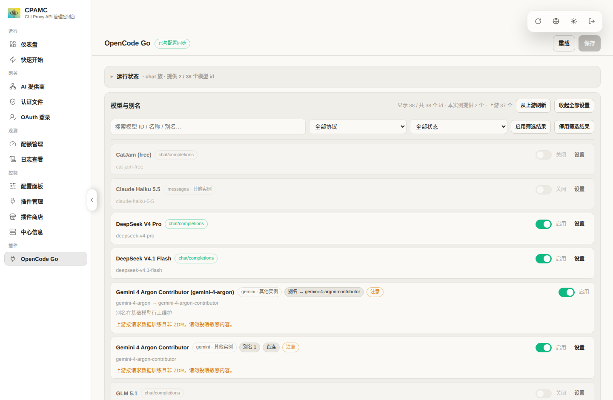

# cpa-opencodego — CLIProxyAPI 的 OpenCode Go Provider 插件

把 [OpenCode Go](https://opencode.ai/docs/go/) 的全部 37 个模型接入 CLIProxyAPI，作为**独立插件**提供，
不改动 CPA 源码，删除插件后不留任何残留。

- 4 个上游协议族全部可用：`chat/completions`、`responses`、`messages`、`gemini generateContent`
- **Gemini 4 Argon Contributor 可用**（CPA 内置 `gemini` provider 组因强制拼接 `/v1beta/` 无法调用它）
- 客户端任意协议都能调用任意模型，协议转换由 **CPA 自己**完成
- 侧边栏「插件」组内出现 `OpenCode Go` 入口，与 token 用量插件平级
- **界面跟随管理中心的深色/浅色主题**（实时同步），并在手机宽度下自动改为单列卡片布局
- **插件页不需要密码**：写入凭据直接复用管理中心已经存好的登录态，插件自己不保存任何密码
- **逐模型别名**：模型列表从上游 `/models` 接口实时拉取，每个模型都能定义任意别名
- 逐模型选择是否走代理（直连 / 代理），真实生效
- **逐模型「设置」按钮**：别名 / 协议 / 代理收进展开面板，折叠时用 chip 显示已改动的项
- **模型搜索框 + 吸顶筛选行**：按 ID / 名称 / 别名搜索，按协议族与状态过滤
- **协议族自动推断**：上游新增的模型按 ID 前缀自动判定走哪个端点，UI 标注「协议推测」，并可一键「探测协议」实测确认
- 多账号 Key 池：加权轮询 + 失败冷却 + 自动切换
- 额度面板：读上游 `/usage` 显示 5 小时 / 本周 / 本月已用百分比与重置时间
- 完全可回滚：删除 4 个 `.so` + 4 个 `plugins.configs.*` 块 + 1 个数据目录即可

---

## 1. 架构：为什么是 4 个 .so

CPA 的插件 executor 以**声明式协议格式**工作：插件声明自己只会一种线上格式
（`executor_input_formats` / `executor_output_formats`），CPA 负责把所有客户端协议翻译成它，
以及把它的输出翻译回客户端协议。

而 OpenCode Go 的模型分布在 4 个上游端点上：

| 上游端点 | 协议格式 | 模型 |
|---|---|---|
| `POST {base}/chat/completions` | `openai` | GLM / Kimi / MiMo / DeepSeek / Qwen / LongCat / Space Bunny / Step5 / MiniMax / Omen … |
| `POST {base}/responses` | `codex` + `openai-response` | Grok 4.7 / 4.6、GPT 6 Luna、GPT 5.6 Luna、Muse Spark |
| `POST {base}/messages` | `claude` | Claude Haiku 5.5 |
| `POST {base}/models/{id}:generateContent` | `gemini` | Gemini 4 Argon Contributor |

格式声明是 per-provider 的，模型所需协议是 per-model 的，因此一个 provider 无法同时承载多种上游协议，
除非插件自己实现协议转换（那要么绑定 CPA 内部包，要么手写转换器，都与"只做消费层"相悖）。

于是同一个程序被编译 4 次（仅链接期常量不同），各自成为一个 provider：

| 插件 ID | provider key | 声明格式 | 上游 |
|---|---|---|---|
| `cap-opencode-go` | `opencode-go` | `["openai"]` | `/chat/completions` |
| `cap-opencode-go-responses` | `opencode-go-responses` | `["codex","openai-response"]` | `/responses` |
| `cap-opencode-go-messages` | `opencode-go-messages` | `["claude"]` | `/messages` |
| `cap-opencode-go-gemini` | `opencode-go-gemini` | `["gemini"]` | `models/{id}:generateContent` |

**只有主插件（`cap-opencode-go`）** 带 `management_api` 与侧边栏菜单，因此 UI 上只有一个入口；
主插件同时是唯一配置源，把解析后的配置写入 `<CPA 根>/data/cap-opencode-go/shared.json`，
其余三个实例按 mtime 惰性读取。四个实例都声明 `model_router`，只认领自己协议族且被启用的模型，
因此可以稳定压过内置 provider 的同名模型（例如现网由 codex OAuth 提供的 `gpt-6-luna`）。

数据流：

```
客户端(任意协议) → CPA 翻译成插件声明格式 → 插件选 Key/选传输 → 原样 POST 上游
                → 上游字节原样回吐 → CPA 翻译回客户端协议
```

插件**不改写 JSON 协议体**（唯一例外：把 body 里的 `stream` 字段与传输模式对齐）。

---

## 2. 环境要求

- CLIProxyAPI v8.x，且构建时 `CGO_ENABLED=1`（`X-CPA-SUPPORT-PLUGIN: 1`）。v8.0.27 已验证。
- 构建插件需要 Go 1.26+（本机验证使用 go1.27.2）。
- 插件 ABI 是 `dlopen` + C ABI（`abi_version = 1`），**不要求与宿主同工具链、同依赖版本**。

---

## 3. 构建

```bash
# 依赖：只需 public sdk 包 + gopkg.in/yaml.v3
# go.mod 里用 replace 指向本地 CPA 源码；如需改为线上模块，删掉 replace 即可。
export PATH=/opt/go/bin:$PATH
export GOPROXY=https://goproxy.cn,direct GOSUMDB=off

make build VERSION=1.2.0   # 产出 dist/cap-opencode-go{,-responses,-messages,-gemini}-v1.2.0.so
make test           # 单元测试
make vet
```

`go.mod` 通过 `replace github.com/router-for-me/CLIProxyAPI/v8 => ../ref/cpa/CLIProxyAPI-v8`
指向固定版本的 CPA 源码。只 import `sdk/pluginapi`、`sdk/pluginabi`，构建不需要下载第三方依赖图。

---

## 4. 安装

```bash
CPA_ROOT=/root/cliproxyapi bash scripts/install.sh 1.2.0
```

脚本只做两件事：把 4 个 `.so` 复制到 `$CPA_ROOT/plugins/linux/amd64/`，并打印需要粘贴的 YAML。
**它不会修改 config.yaml** —— 插件开关与 provider 配置由宿主配置拥有。

把下面的块并入 config.yaml 的 `plugins:` 段：

```yaml
plugins:
  enabled: true
  dir: "plugins"
  configs:
    cap-opencode-go:
      enabled: true
      priority: 10
      base-url: "https://opencode.ai/inference/go/v1"
      session-mode: "auto"
      session: "$CPA-SESSION-ID"
      default-proxy: "proxy"
      keys:
        - name: "main"
          key: "oc_sk_xxx"
          weight: 1
          enabled: true
      models:
        "gpt-6-luna":                 { enabled: true, proxy: proxy }
        "gemini-4-argon-contributor": { enabled: true, proxy: direct }
    cap-opencode-go-responses: { enabled: true }
    cap-opencode-go-messages:  { enabled: true }
    cap-opencode-go-gemini:    { enabled: true }
```

然后 `systemctl restart cliproxyapi`。四个实例必须同时启用。

---

## 5. 配置参考

只有 `plugins.configs.cap-opencode-go` 需要写业务字段，其余三个实例只需 `enabled: true`。

| 字段 | 类型 | 默认 | 说明 |
|---|---|---|---|
| `base-url` | string | `https://opencode.ai/inference/go/v1` | 接口基址；`https://opencode.ai/zen/go/v1` 亦可 |
| `keys` | array | 空 | `[{name, key, weight, enabled}]`，多账号 Key 池 |
| `models` | object | 空 | `{"<model-id>": {enabled, proxy, family, aliases}}` 逐模型覆盖 |
| `models-default` | object | 空 | 未单独列出的模型的统一设置 |
| `default-proxy` | enum | `inherit` | `inherit` / `proxy` / `direct` |
| `proxy-url` | string | 空 | 插件专用代理；留空继承 CPA `requests.proxy-url`；`direct`/`none` 表示强制直连 |
| `session-mode` | enum | `auto` | `auto` 跟随 CPA 会话 ID，`fixed` 用 `session` 值 |
| `session` | string | `$CPA-SESSION-ID` | `x-opencode-session` 的固定值 |
| `request-timeout-seconds` | int | 900 | 上游超时 |
| `key-cooldown-seconds` | int | 60 | Key 失败后冷却时长 |
| `max-retries` | int | 2 | 单个请求最多切换 Key 的次数 |
| `extra-headers` | object | 空 | 追加到上游请求的请求头 |
| `state-dir` | string | `<root>/data/cap-opencode-go` | 插件自有状态目录 |
| `debug` | bool | false | 写流式诊断到 `<state-dir>/debug.log` |

### 代理语义

按模型解析，优先级：模型级 `proxy` → `default-proxy` → 插件 `proxy-url` → CPA `requests.proxy-url`。

- `proxy`：走插件 `proxy-url`，未设置则走 CPA 全局代理
- `direct`：强制直连（显式设置 `Transport.Proxy = nil`，不受环境变量影响）
- `inherit`：按上面的顺序继承

`gemini-4-argon-contributor` 实测**必须直连**；`gpt-6-luna` / `grok-4.7` 等 responses 家族
实测**必须走代理**（直连返回 `403 unsupported_country_region_territory`），因此安装示例里已分别设置。

### 模型别名

给模型配别名后，客户端既可以用原名也可以直接用别名调用，别名与原模型共享协议、代理与 Key：

```yaml
models:
  "grok-4.7":
    enabled: true
    proxy: proxy
    aliases: ["grok", "grok4"]      # 数组；仪表盘里用逗号分隔填写
```

- 别名会被注册进 `/v1/models`（`owned_by: opencode`），因此可以直接被客户端发现
- 路由阶段按别名认领，执行阶段由插件把请求体里的 `model` 改写成真实上游 id
- 别名与真实模型 id 冲突时**真实 id 优先**，冲突会以「别名被占用」标记显示在仪表盘上
- 关闭某模型时，它的别名一并失效
- 别名不会跨协议族：别名继承基础模型的协议族（例如 `responses`）

> 上游新增的模型（`/api/models` 里标记「上游新增」）默认**不启用**。在仪表盘上给它选一个「上游协议」并打开开关即可使用，无需重新编译插件。

### Key 池

加权轮询（`weight`），上游 401/403/408/429/5xx 时自动换下一个 Key 并在冷却期内跳过它；
400/404 视为请求本身的问题，不换 Key，原样回传上游错误与状态码。

---

## 6. 仪表盘

侧边栏「插件」组 → `OpenCode Go`（iframe，路径 `/v0/resource/plugins/cap-opencode-go/dashboard`）。

页面结构：**顶部操作栏**（标题 + 同步状态 + 「重载」「保存」）→ 运行状态（可折叠）→ 模型与别名 →
额度余量 → Key 池 → 插件实例 → 高级设置。

| 手机端（模型列表） | 手机端（逐模型设置） | 桌面端 |
|---|---|---|
|  |  |  |

- **模型与别名**（页面第一块）：搜索框（ID / 名称 / 别名）、协议筛选、状态筛选、
  「启用/停用筛选结果」批量操作、「从上游刷新」；筛选行在滚动时吸顶
- **逐模型设置**：默认只显示「显示名 + 状态/协议 chip + 上游 id + 启用开关 + 设置按钮」，
  点「设置」才展开别名 / 上游协议 / 代理 / 探测协议 / 恢复默认
- **额度余量**：逐 Key 显示 5 小时 / 本周 / 本月已用百分比与重置时间（数据来自 `GET {base}/usage`）
- **Key 池**：名称、掩码 Key、权重、启用、成功/失败计数、冷却状态；行内表单添加、一键移除
- **高级设置**：base-url、session、代理、超时、冷却、状态目录

### 为什么不需要密码

插件页**不实现任何认证**，也从不询问密码：

- 写入仍然走 CPA 自己的 `/v8/management/config/plugins/configs/<id>`（Bearer 管理密钥），
  但密钥是从管理中心自己的浏览器存储 `localStorage['cli-proxy-auth']` 里**静默读取**的
  （zustand persist 名 + `enc::v1::` 混淆；旧版 `localStorage['managementKey']` 作为兜底）。
  管理中心登录时勾了「记住密码」就一定能读到；在别的标签页勾上后本页会自动变为可写（监听 `storage` 事件）
- 读不到的场合（没勾「记住密码」，浏览器里根本不存在密钥）页面进入**只读模式**：
  顶部显示「只读」并给出一次性解决提示，保存按钮禁用，**不弹任何密码框**；
  状态、额度、模型列表照常显示（这些走插件自己的免鉴权只读接口）
- 插件自身不在磁盘上保存任何凭据，`sessionStorage` 也不再用

### 手机端布局

- 页面是「顶部操作栏 + 单块可滚动区域」的 flex 列，**刻意不放底部固定条**：
  管理中心在手机上会用自己的 `min-height:100vh` 撑页面，iframe 下方可能留出一条它自己的空白，
  任何贴底元素都会浮在那条空白上方。操作栏放在顶部后，页面在 iframe 底边自然结束
- 顶部内容按**实测**的管理中心 header 高度（`--host-header`）下移，header 不会压住插件内容
- ≤900px 收窄为两列，≤640px 变单列卡片、表格转成带标签的分块、按钮等宽

写入后宿主热重载并回调 `plugin.reconfigure`，插件**不直接写 config.yaml**。

只读接口（同源 iframe、免鉴权、绝不返回明文 Key）：

- `GET /v0/resource/plugins/cap-opencode-go/api/state` — 配置与运行状态（不含上游调用）
- `GET /v0/resource/plugins/cap-opencode-go/api/models[?refresh=1]` — 上游模型列表与本插件配置的合并视图（上游结果缓存 5 分钟）
- `GET /v0/resource/plugins/cap-opencode-go/api/quota`

需要鉴权的接口（宿主管理中间件校验，与其它管理 API 同一把密钥）：

- `GET /v0/management/opencode-go/probe?model=<id>` — 逐个协议族发一次最小请求，返回哪一族真正可用
  （`/v8/management/opencode-go/probe` 亦可，页面优先用 v8 前缀）

---

## 7. 回滚

```bash
CPA_ROOT=/root/cliproxyapi bash scripts/uninstall.sh
# 手动删除 config.yaml 里 4 个 plugins.configs.cap-opencode-go* 块
systemctl restart cliproxyapi
```

插件**不写入** CPA 的任何其它状态：不建 auth 文件、不改 provider 组、不写数据库。
唯一的落盘物是 `data/cap-opencode-go/`（主插件发布的共享快照 + 可选 debug.log），由脚本删除。

实测（临时实例）：删除后 `/v1/models` 回到 0 个模型、`/v8/management/plugins` 为空、
`/v0/resource/plugins/cap-opencode-go/dashboard` 返回 404、`data/` 无残留、auth 目录为空。

---

## 8. 已知取舍与限制

- **出站请求日志**：插件用自己的 `http.Client` 才能实现逐模型代理开关，代价是这些出站请求
  不进 CPA 的请求日志。token 用量统计不受影响——宿主仍会解析我们返回的 payload 并投递给用量插件。
- **不要在分离 goroutine 里调用 `host.log`**：实测会段错误（SIGSEGV）导致宿主进程崩溃。
  本插件的诊断改写到 `<state-dir>/debug.log`（`debug: true` 时）。
- **responses 家族必须同时声明 `codex` 与 `openai-response`**：只声明 `codex` 时，宿主会发现
  `codex → openai-response` 流式翻译结果与输入逐字节相同，判定为"注册表回退"并**丢弃全部帧**，
  表现为流式请求 502 `upstream stream closed before first payload`。
- **responses 家族的非流式输出必须包成终止事件**：宿主的 `codex → openai` / `codex → claude`
  非流式翻译器只接受事件载荷（`{"type":"response.completed","response":{…}}`），收到裸的
  response 对象会返回空 body，表现为「HTTP 200 但内容为空」。插件在 `Format == "codex"`
  时自动包一层；内置 codex executor 因为始终流式上游，从未踩到这个坑。
- **Gemini 4 Argon 的数据条款**：上游按请求数据训练且非 ZDR，请勿投喂敏感内容（仪表盘已标注）。
- **模型目录与协议归属**：内置 37 个模型及其协议归属（依据官方文档 + 实测）。`family` 可按模型覆盖；
  未知 id 按前缀推断（`claude-*` → messages，`gemini-*` → gemini，`gpt-*` / `grok-*` / `muse-*` → responses，
  其余 → chat），单测保证该规则与内置表对全部 37 个模型一致。UI 对推断结果标注「协议推测」，
  可用「探测协议」实测（会向上游各发一次极小请求）或手选覆盖。**上游新增模型不需要重新编译插件**。
- **协议探测是唯一会额外消耗配额的功能**，且只在点按钮时发生（每个协议族一次、最多 4 次）。

---

## 9. 验收

```bash
CPA_BASE=http://127.0.0.1:8399 \
CPA_CLIENT_KEY=sk-xxx \
CPA_MGMT_KEY=mgmt-key \
bash scripts/acceptance.sh
```

17 项检查覆盖 4 个协议族的流式/非流式、跨协议调用、模型目录、侧边栏入口、状态与额度接口。
在 v8.0.27 上的实测结果见 [docs/acceptance.md](docs/acceptance.md)。

---

## 10. 目录

```
cmd/plugin/            单一 main 包，编译 4 次（-ldflags -X main.role=…）
internal/abi/          C ABI 的 JSON envelope 协议
internal/plugin/       RPC 分发、注册、模型路由、executor、管理页
internal/upstream/     上游 HTTP、逐模型传输、失败切换
internal/keys/         Key 池：加权轮询与冷却
internal/config/       配置解析、默认值、共享快照
internal/roles/        4 个协议族的路径与格式定义
internal/models/       模型目录（id → 协议族）
internal/quota/        /usage 额度读取
internal/dashboard/    内置中文仪表盘（embed 字符串）
scripts/               install / uninstall / acceptance
docs/                  design / rollback / acceptance
```

---

## 11. 变更记录

### 1.2.0

- **手机端布局重做**：顶部操作栏 + 单块滚动区；不再有底部固定条（管理中心手机端会在 iframe 下留一条
  自己的空白，贴底元素会浮在它上方）；顶部按实测的管理中心 header 高度下移，不再被 header 压住
- **插件页彻底去掉密码**：写入凭据静默复用管理中心已存的登录态，删除全部密钥输入/弹窗/sessionStorage；
  取不到凭证时进入只读模式并给出提示
- **模型区提到首屏**：吸顶搜索行（ID / 名称 / 别名）+ 协议/状态筛选 + 批量启用停用
- **逐模型设置收起**：别名 / 协议 / 代理进「设置」面板，折叠时用 chip 显示改动
- **协议族前缀推断 + 协议探测**：上游新增模型开箱可用，UI 标注「协议推测」，可实测确认
- Key 池改用行内表单添加；运行状态卡片默认折叠

### 1.1.1

- 修复 responses 家族非流式调用返回空 body（终止事件包装）
- 修复重启后注册阶段拿不到宿主代理导致直连 403

