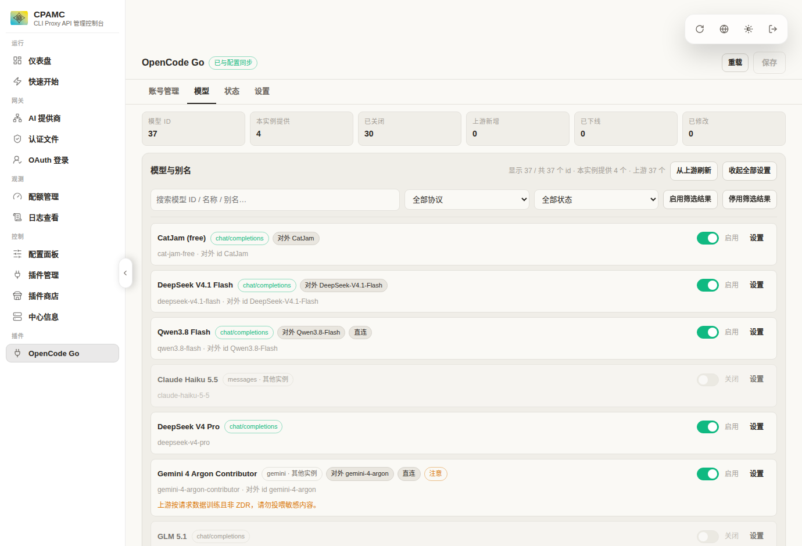
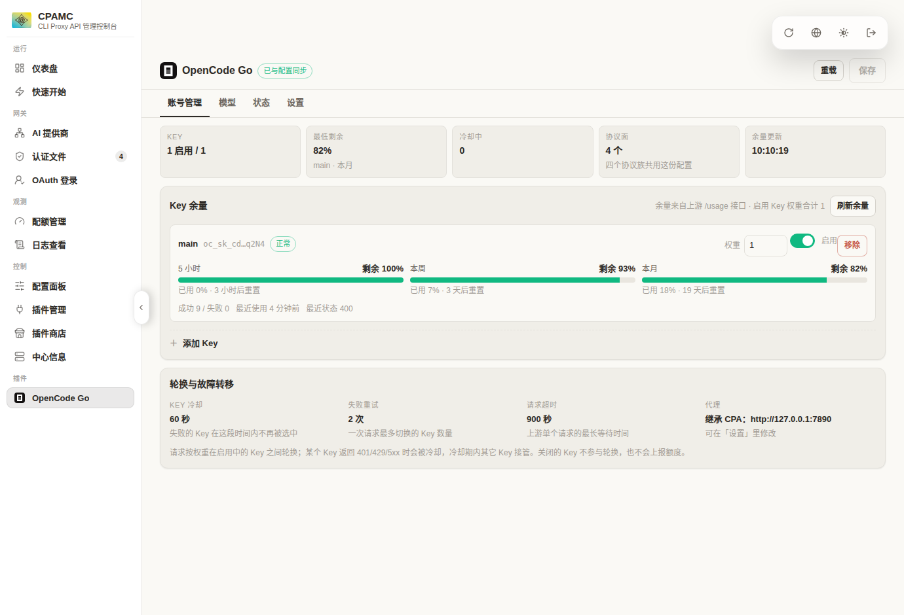
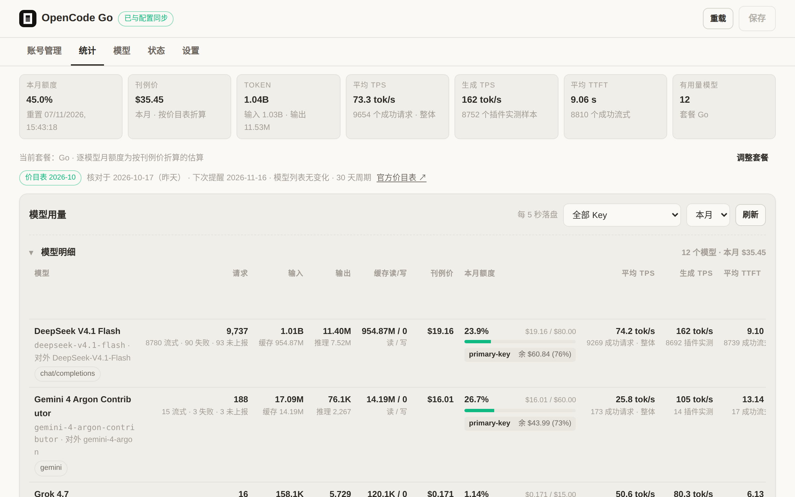
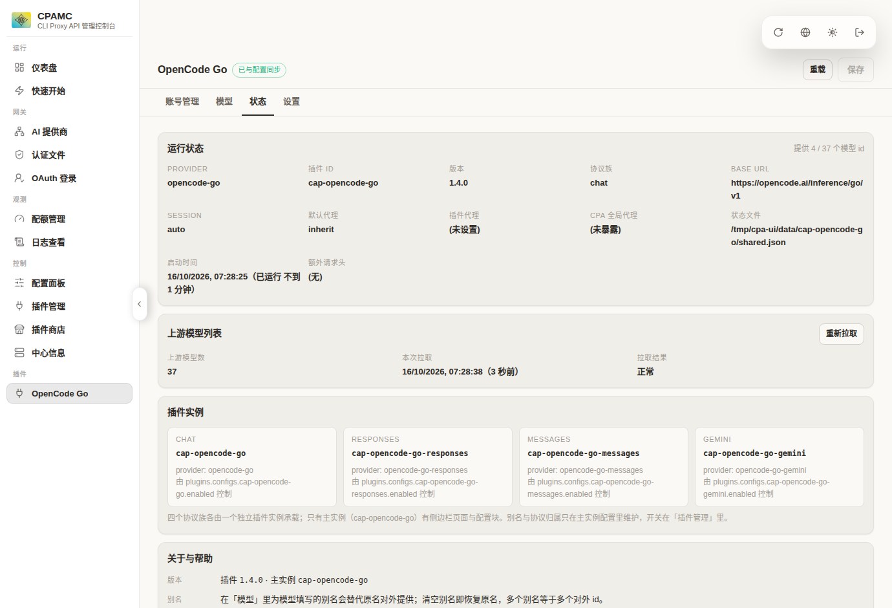

<div align="center">

# OpenCode Go Provider プラグイン

**OpenCode Go の全 37 モデルを CLIProxyAPI に完全統合するネイティブプラグイン**

[ 简体中文 ](README.md) | [ English ](README_en.md) | [ 日本語 ](README_ja.md) | [ Français ](README_fr.md) | [ 한국어 ](README_ko.md)

<p>
  
  
  
  
</p>

</div>

---

> **v2.0.2**：developer ロールおよび reasoning 回放の 400 互換対応をデフォルト `retry-only` の遅延修復に変更し、セッション sticky 記憶を追加しました。アップグレード前に [v2 アップグレードガイド](docs/UPGRADE-v2.md) をご覧ください。


## 主な特徴と提供価値

OpenCode Go には最新鋭の LLM（DeepSeek V4.1、Claude Haiku 5.5、Gemini 4 Argon、GPT 6 Luna、Grok 4.7、Qwen 3.8、Kimi K3 など）37 種が集約されています。しかし、モデルごとに 4 つの異なるエンドポイントに分散しており、モデルごとのプロキシ要件も異なります。

本プラグインは、CLIProxyAPI (CPA) 向けに以下のソリューションを提供します：
- **4大プロトコルファミリーを完全網羅**：`chat/completions`、`responses`、`messages`、`generateContent` のすべてを統合。クライアントは任意のプロトコルで全モデルを呼び出せます。
- **モデルごとの個別プロキシ設定**：モデル単位で「プロキシ経由」「直接接続」「全体設定を継承」を自由に切り替え可能。
- **ネイティブ統合管理コンソール**：CPA 管理画面から直接アクセスできる専用 Web UI を搭載。複数キーの重み付け管理、リアルタイムの残量可視化、実測 TPS・初回トークン遅延（TTFT）を直感的に把握できます。
- **完全クリーン＆残余ゼロ**：動的ライブラリ（.so）形式で動作し、CPA 本体のソースコードやデータベースを変更しません。アンインストール時もシステムに痕跡を残しません。

---

## 機能ハイライト（UI スクリーンショット）

### 1. モデルごとの個別プロキシ選択とエイリアス設定

> **注目ポイント**：モデルごとに最適なネットワーク経路を個別に指定でき、用途に応じた別名（エイリアス）での呼び出しが可能です。



- **モデルごとのプロキシ個別制御**：
  - `プロキシ経由 (proxy)`：地域制限のあるモデル（GPT 6 Luna、Grok 4.7 などの Responses 系統）にピンポイントでプロキシを適用。
  - `直接接続 (direct)`：プロキシをバイパスして直接アクセス（Gemini 4 Argon Contributor など、地域制限回避のために直接接続が必要なモデルに最適）。
  - `継承 (inherit)`：プラグイン設定または CPA 本体のグローバルプロキシ設定をそのまま引き継ぎ。
- **モデル名のエイリアス（別名）化**：クライアント向けに好みの名前を設定可能（例: `deepseek-v4.1-flash` を `DeepSeek-V4.1-Flash` として公開）。
- **プロトコルの自動推論と検証**：上流に追加された未知のモデルも ID 接頭辞からエンドポイントを自動判定。「プロトコル検出」ボタンから最小リクエストを送り、実際に通信できるか即座に確認できます。

---

### 2. 複数キー管理とリアルタイム枠残量モニタリング

> **注目ポイント**：上流の「5時間・週間・月間」の枠残量をグラフィカルに常時把握。複数キーの優先順位制御に対応。



- **マルチウィンドウ残量可視化**：OpenCode Go 上流の `/usage` API から直接データを取得。5時間ローリング、週間枠、月間枠の残量パーセンテージと更新までの残り時間を表示。
- **優先順位付きキー運用**：複数の API キーを登録し、優先度（Priority）に応じた自動振り分けやフェイルオーバーに対応。
- **インプレース即時改名**：画面上のキー名をクリックするだけで編集可能。設定は自動でホットリロードされ、再起動は不要です。

---

### 3. 詳細なトークン利用量と実測パフォーマンス統計

> **注目ポイント**：トークン消費量、公式価格換算、エンドツーエンド全体 TPS、純粋な生成 TPS、初回トークン遅延（TTFT）を包括的に記録。



- **実測パフォーマンス指標**：
  - **全体 TPS**：成功リクエストの有効出力 ÷ CPA 側全処理時間（接続・待ち時間・ネットワーク遅延を含む実効値）。
  - **生成 TPS**：プラグインが計測した初回トークンから最終トークンまでの時間で算出（純粋なデコード速度）。
  - **平均 TTFT**：リクエスト送信から最初の有効トークンを受信するまでの所要時間。
- **コスト・限度額の進捗表示**：内蔵の公式価格表に基づき、Go / Go Plus プランの月間枠消費状況をモデルごとに自動計算。キーごとの残額も一目で分かります。
- **更新リマインダー**：30 日経過時または上流モデル一覧に変更があった際、画面上部で更新確認を促します。
- **リクエストログ**：新しいタブで、各上流試行の時刻・入力/出力/合計トークン・TTFT・生成 TPS・エンドツーエンド TPS・状態・エラーを一覧表示します。失敗理由と上流の `x-opencode-log-id` も確認できます。

---

### 4. 4大プロトコル面の一体化アーキテクチャ

> **注目ポイント**：単一の設定で 4 つのプロトコル面を同時に稼働させ、プロトコルの違いを完全吸収。



- **4 つの面が 1 つの製品として動作**：メインプラグインが Web UI と設定を統括し、3 つの従属面（Responses / Messages / Gemini）が自動で同期して動作。
- **相互プロトコル変換**：OpenAI 形式のクライアントから Claude モデルを呼ぶ、または Anthropic 形式のクライアントから Gemini 4 や DeepSeek を呼ぶ操作が透過的に行われます。
- **シンプルな設定管理**：設定が必要なのはメインプラグインのみ。従属面は設定不要で稼働します。

---

## クイックスタート

### ステップ 1：プラグインライブラリの配置

ビルド済みの 4 つの `.so` ファイルを CPA のプラグインフォルダ（通常 `plugins/linux/amd64/`）に配置します：
- `cpa-opencodego-v2.0.2.so`
- `cpa-opencodego-responses-v2.0.2.so`
- `cpa-opencodego-messages-v2.0.2.so`
- `cpa-opencodego-gemini-v2.0.2.so`

### ステップ 2：設定ファイルの追記

CPA の `config.yaml` 内 `plugins:` セクションに以下を追記します：

```yaml
plugins:
  enabled: true
  dir: "plugins"
  configs:
    cpa-opencodego:
      enabled: true
      base-url: "https://opencode.ai/inference/go"
      endpoint-layout: "auto"
      developer-role: "retry-only"
      reasoning-replay: "retry-only"
      request-log: true
      keys:
        - name: "primary-key"
          key: "oc_sk_your_api_key_here"
          priority: 10
          enabled: true
    cpa-opencodego-responses: { enabled: true }
    cpa-opencodego-messages:  { enabled: true }
    cpa-opencodego-gemini:    { enabled: true }
```

### ステップ 3：Web UI から管理開始

1. CLIProxyAPI を起動（または再起動）します。
2. 管理画面のサイドバー「プラグイン」から **OpenCode Go** を開きます。
3. モデルの個別プロキシ設定、残量モニタリング、パフォーマンス統計を自由にご活用ください！

---

## 技術詳細と設計ドキュメント

4 つの `.so` の動作原理、C ABI 通信、SSE 初回フレーム計測機構、全設定パラメータ一覧、ビルド手順については以下のドキュメントをご参照ください：

- 📖 [技術仕様と全設定パラメータリファレンス (docs/TECHNICAL.md)](docs/TECHNICAL.md)
- 📐 [コア設計ドキュメント (docs/design.md)](docs/design.md)
- 🛡️ [残余ゼロ・安全なロールバックガイド (docs/rollback.md)](docs/rollback.md)
- 🧪 [受け入れテストと検証レポート (docs/acceptance.md)](docs/acceptance.md)

---

## ライセンス

本プロジェクトは [MIT License](LICENSE.txt) のもとで公開されています。
